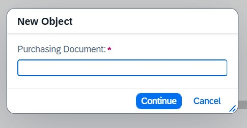

# SAP RAP – Purchase Order Tracker

A Fiori Elements application built using the **ABAP RESTful Application Programming Model (RAP)**
to create, view, edit and track Purchase Orders.

## Features
- Managed RAP business object with **draft** support
- Full CRUD operations (Create, Read, Update, Delete)
- Fiori Elements **List Report** and **Object Page** generated purely from annotations
- Object page organised into facets: Purchase, Finance, Quantity and Status
- Amount and quantity fields with currency/unit semantics and value helps
- Admin fields (created/changed by and at) filled automatically by the framework
- Optimistic locking using ETags
- App accessible from the **Fiori Launchpad**

## Tech Stack
SAP BTP ABAP Environment / S/4HANA · ABAP Development Tools (Eclipse) · CDS View Entities ·
Behavior Definitions · OData V4 · SAP Fiori Elements

## Architecture
Database Table → Interface CDS View → Projection CDS View → Metadata Extension
→ Behavior Definition → Service Definition → Service Binding (OData V4) → Fiori Elements App

## Project Objects
| Object | Name | Purpose |
|---|---|---|
| Database Table | `ZPO_TRACKER` | Stores Purchase Order data |
| Draft Table | `ZPO_D_TRACKER` | Holds unsaved draft data |
| Interface View | `ZI_PO_TRACKER` | Root CDS view entity (base data model) |
| Projection View | `ZC_PO_TRACKER` | Exposes fields to the Fiori UI |
| Metadata Extension | `ZC_PO_TRACKER` | UI annotations: columns, filters, facets, field groups |
| Behavior Definition | `ZI_PO_TRACKER` | Managed + draft, CRUD, field control, determinations |
| Projection Behavior | `ZC_PO_TRACKER` | Exposes CRUD and draft actions |
| Behavior Pool | `ZBP_I_PO_TRACKER` | Behavior implementation logic |

## Screenshots

### Fiori Launchpad

### List Report

### Create Screen

### Edit Mode

### Input

## What I Learned
- Designing a layered RAP data model with interface and projection views
- Handling amount/quantity semantics in Fiori UIs
- Implementing draft handling, ETags and determinations in a managed scenario
- Building a complete Fiori Elements app using only CDS annotations, no UI5 code
